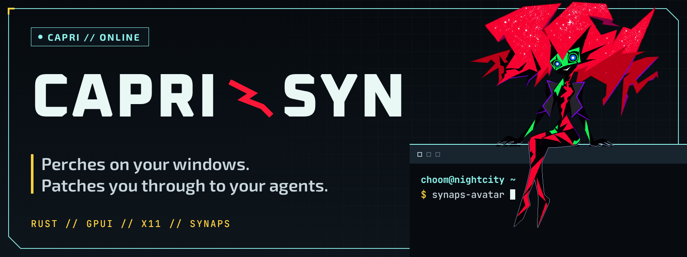
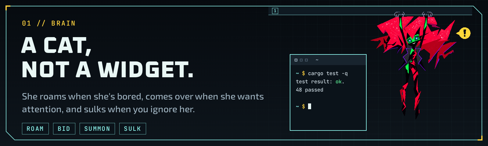
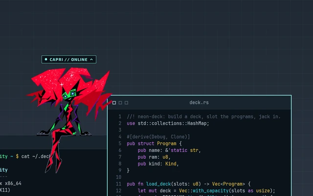
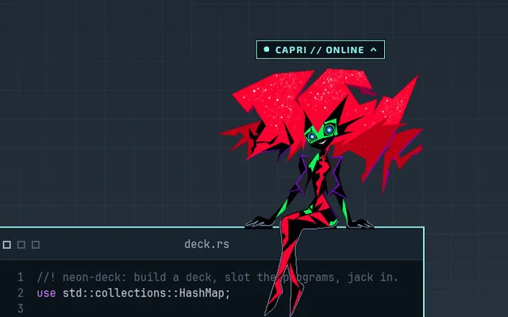
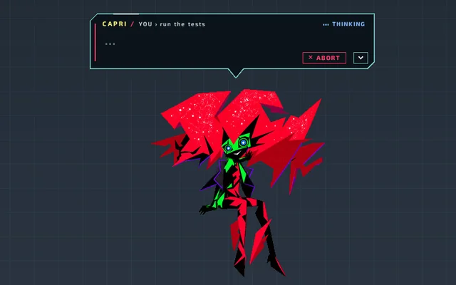
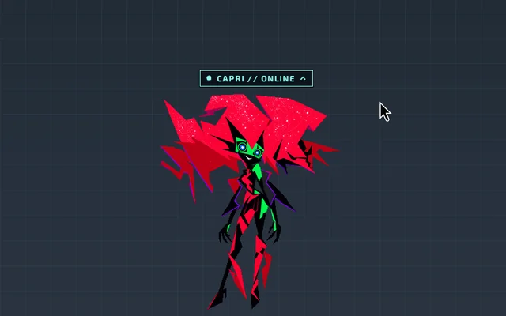
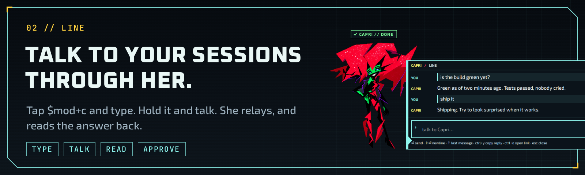
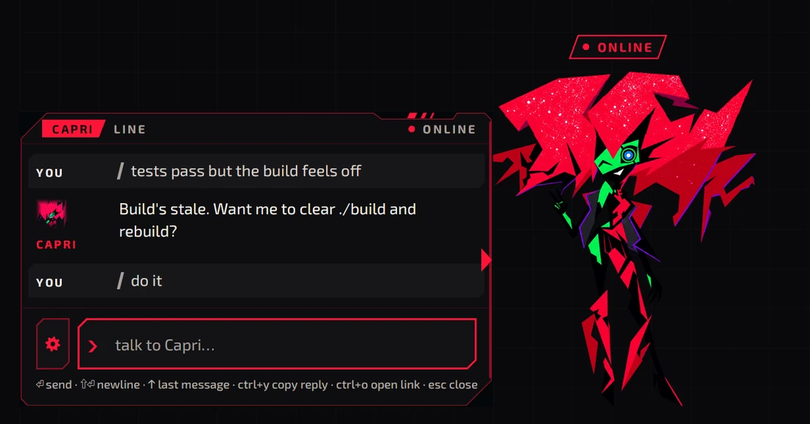
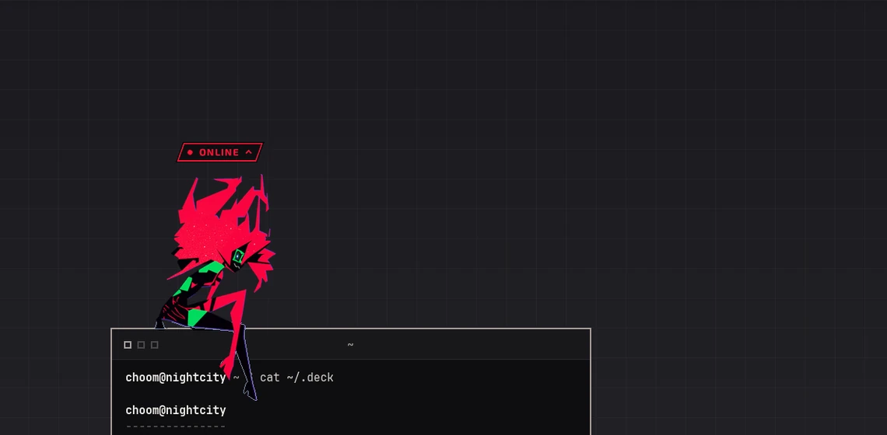
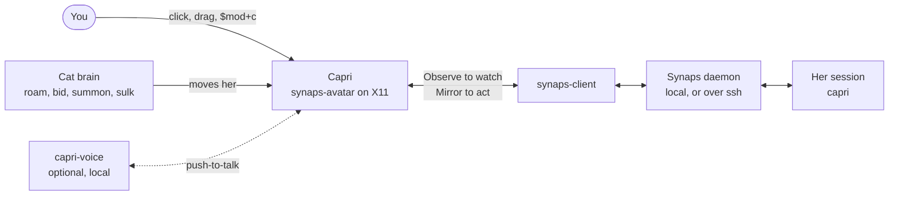

<h1 align="center">
  
</h1>

<p align="center">
  
  
  
  
  
</p>

<p align="center">
  <a href="#she-lives-here">Features</a> ·
  <a href="#how-it-works">How it works</a> ·
  <a href="#install">Install</a> ·
  <a href="#configure">Configure</a> ·
  <a href="#controls">Controls</a> ·
  <a href="#credits--legal">Credits</a>
</p>

<p align="center">
  
  <br>
  <sub>Glitches in. Sits down. Tells you when your agent needs you.</sub>
</p>

**Capri** lives on your desktop. She perches on window edges, wanders off when she's bored, and hangs
from your bar when she wants attention. She is also a client of your
[Synaps](https://github.com/HaseebKhalid1507/SynapsCLI) daemon with a session of her own: tap a key and
type (or hold it and talk), and she relays it, reads the answer back, and comes to find you when an agent
is waiting on a yes.

She's a click-through overlay on X11, written in Rust and drawn with GPUI. Your windows stay yours. She
just sits on them.

<p align="center"></p>

## She lives here

Nobody scripts her day. Two drives run in the background, one for wandering and one for attention, and
she acts when one of them wins.

<table>
  <tr>
    <td width="50%" align="center"><br><b>Teleport</b><br><sub>Tears out in scanlines. Lands where she meant to.</sub></td>
    <td width="50%" align="center"><br><b>Perch</b><br><sub>Sits on your windows. Rides along when they move.</sub></td>
  </tr>
  <tr>
    <td width="50%" align="center"><br><b>Attention bids</b><br><sub>Wants attention. Will hang off your bar for it.</sub></td>
    <td width="50%" align="center"><br><b>Ragdoll</b><br><sub>Grab her, shake her, fling her. She lands it.</sub></td>
  </tr>
</table>

<p align="center"></p>

<table>
  <tr>
    <td width="50%" align="center"><br><b>Headpats</b><br><sub>Headpats are supported. Hearts are not optional.</sub></td>
    <td width="50%" align="center"><br><b>Music</b><br><sub>Something's playing? Headphones on.</sub></td>
  </tr>
  <tr>
    <td width="50%" align="center"><br><b>Moods</b><br><sub>Her mood is your session's: thinking, working, done.</sub></td>
    <td width="50%" align="center"><br><b>Facing</b><br><sub>Drag her one way. She looks back the other.</sub></td>
  </tr>
</table>

<p align="center"></p>

## She's your line in

Capri has her own Synaps session, named `capri`. The Line is how you reach it without leaving what
you're doing.

<p align="center">
  
  <br><b>The Line</b><br>
  <sub>Tap $mod+c. Type. She relays it to her session.</sub>
</p>

<p align="center">
  
  <br><b>Hold to allow</b><br>
  <sub>Risky tool call? Hold A. A tap does nothing.</sub>
</p>

<p align="center">
  
  <br><b>Reader</b><br>
  <sub>Long reply? It opens in a reader, not a bubble.</sub>
</p>

<p align="center">
  
  <br><b>Voice</b><br>
  <sub>Hold the key, talk, let go. She answers aloud.</sub>
</p>

- **The thread stays open.** Enter sends, or steers a turn that's already running. Esc closes and keeps
  your draft. Esc Esc aborts the turn.
- **A reply you missed waits for you.** It leaves a one-line strip on her tag until you look.
- **Prompts are answered from the keyboard.** <kbd>A</kbd> allows, <kbd>D</kbd> denies, <kbd>Tab</kbd>
  lets you say something instead, <kbd>Esc</kbd> puts it off. Anything that runs, writes or deletes needs
  <kbd>A</kbd> held for about half a second, so a stray keypress can't approve it.
- **Long replies and code open in a reader** beside her, with copy buttons, instead of a speech bubble.
- **Voice is opt-in and local.** Hold the key to talk and let go to send. Speech-to-text is whisper.cpp
  and her voice is Kokoro, both on the CPU. Say **"Hey Capri"** to start a turn hands-off: that keeps one mic
  stream open, always shown on her tag (`wake_word = false` turns it off). Audio stays in memory, and
  nothing is written to disk.

## How it works



She is one process: a transparent GPUI window on X11 plus a client of the Synaps daemon. The daemon can be
on this machine or on another one behind an ssh tunnel.

**She watches, and only steps in to act.** Capri attaches to her session in `Observe`. A `Mirror` attach
would keep the session from parking and cost tokens in keep-warm pings, so she takes one only to send,
answer a prompt or abort, and drops back to `Observe` three seconds after the turn ends.

**Her own session.** With no `--session` flag she uses a session named after the pack's character
(`capri`): attaches if it's live, resumes it if she remembers it, creates it otherwise. She rides another
session only when you pass `--session`, and she refuses the one named `subconscious`.

**Her mood is the session's.** Thinking, working (with the tool's name), talking, done, annoyed after an
abort or an error, needs-you while a prompt is pending, sleepy after ten quiet minutes, away when the
daemon is gone. Away fixes itself when the daemon comes back.

### The cat brain

- **Roam.** Every 45 seconds to 3 minutes she picks a new spot, most often the top edge of a window (her
  favourite), else the floor or a corner. Four times in five it's on the monitor your pointer is on. In
  between she does small hops: along the edge she sits on, to the next window over, down and back up.
- **React.** Switch windows and about one time in three she hops to the new one's edge. Drag her window
  fast and she hops off, startled. Bring the pointer close and she looks at it; swipe past and she
  startles; rest it on her and she dodges or leans in for a headpat. Switch workspace and she follows
  you within a couple of seconds. Close the window she's sitting on and, a bit over half the time, she
  glitches over to the top of another one; otherwise she falls. While you type fast she only does the
  small hops, away from your window; after two idle minutes she explores.
- **Bid.** Leave her alone long enough (8 to 15 minutes) and she comes over: hanging from the bar above
  your window, clinging to its side, sitting on its edge, peeking round a corner. She avoids
  her last two entrances. Ignore the bid and she insists, then sulks and keeps her distance for a while. A headpat settles it.
- **Summon.** When her session needs you (a prompt, a finished turn, an error) she comes straight to the
  window you're in, unless she's already beside you. This is the one move that isn't her idea.
- **Manners.** She doesn't wander off mid-conversation: an open bubble, the Line or her menu keeps her
  where she is. She hides when a window goes fullscreen on her monitor, makes at most 45 moves an hour on
  her own (a small hop counts a quarter), stays off the window you're working in unless she's come over for you, and
  takes `DND 1 HOUR` from the right-click menu.

## Install

> [!NOTE]
> **What you need today.** Linux on X11 (i3 is what it's built and tested on). A running
> [Synaps](https://github.com/HaseebKhalid1507/SynapsCLI) daemon. Read access to the `synaps-client`
> crate, which currently lives in a private repository: without it the build can't fetch its
> dependencies. A [CapriCore](https://github.com/CapriChooms/CapriCore) checkout for the art, which is
> not in this repo.

**1. Build.** The toolchain is pinned in `rust-toolchain.toml` (1.100.0).

```sh
git clone https://github.com/HaseebKhalid1507/capri-syn && cd capri-syn
cargo build --release
install -Dm755 target/release/synaps-avatar ~/.local/bin/synaps-avatar
install -Dm755 tools/avatarctl ~/.local/bin/avatarctl
```

System libraries on Debian/Ubuntu, as CI installs them:

```sh
sudo apt-get install -y --no-install-recommends \
  pkg-config libxkbcommon-dev libxkbcommon-x11-dev libwayland-dev libvulkan-dev \
  libx11-xcb-dev libxcb1-dev libxcb-shape0-dev libxcb-randr0-dev libxcb-xfixes0-dev \
  libfontconfig-dev libfreetype-dev libasound2-dev libssl-dev libzstd-dev
```

It renders through Vulkan, so you also need a Vulkan driver for your GPU (Mesa's on Intel and AMD).

**2. Assemble her pack.** The art is CapriChooms's and stays out of this repository. `make-pack` copies
it from your own CapriCore checkout (v1.0.4, the look she wears; it refuses others) into
`~/.local/share/synaps-avatar/packs/capri` (it needs Python's `fonttools`).

```sh
git clone https://github.com/CapriChooms/CapriCore /tmp/CapriCore
git -C /tmp/CapriCore checkout v1.0.4
tools/make-pack /tmp/CapriCore
synaps-avatar --check        # loads the pack and verifies every frame, no window
```

**3. Run.**

```sh
synaps-avatar                        # her own session on the default daemon
synaps-avatar --session work         # ride a session you already have
synaps-avatar --no-session           # just the body, no daemon
```

**The daemon is on another machine?** `tools/synaps-avatar-remote <host>` forwards that host's daemon
socket over `ssh -L`, runs the avatar against it, restarts the tunnel if ssh drops (she shows Away
meanwhile), and cleans up when she exits.

```sh
tools/synaps-avatar-remote <host> [avatar args...]
```

**The summon key.** The app doesn't grab a global key. Bind one in your window manager to the two control
commands. In i3:

```
bindsym $mod+c           exec --no-startup-id avatarctl talk press
bindsym --release $mod+c exec --no-startup-id avatarctl talk release
```

A tap opens the Line on the monitor you're working on and she teleports over. A hold is push-to-talk,
if voice is on.

**Voice (optional).** A sidecar, `capri-voice`, owns the mic and the speech models. The setup script
uses `uv` for a user-local venv and expects `pywhispercpp` from your distribution
(`python-pywhispercpp-cpu` on Arch); nothing is installed system-wide.

```sh
tools/capri-voice-setup                       # venv + models under ~/.local/share/capri-voice
install -Dm755 tools/capri-voice ~/.local/bin/capri-voice
mkdir -p ~/.config/systemd/user
cp tools/systemd/capri-voice.service ~/.config/systemd/user/
systemctl --user daemon-reload && systemctl --user enable --now capri-voice
```

Then set `[voice] enabled = true`.

## Configure

Settings live in `~/.config/synaps-avatar/settings.toml`. Every key is optional. This file shows the
defaults.

```toml
[brain]
enabled = true
attention = "mix"            # "mix" | "hang_only" | "off"  (also in the right-click menu)
fullscreen = "hide"          # "hide" | "stay"
monitor = "follow"           # "follow" the monitor you work on | "any"
passive_every_min = [0.75, 3] # minutes between her own roams (micro-hops in between)
bid_every_min = [8, 15]      # minutes between attention bids
max_moves_per_hour = 45      # a micro-hop counts a quarter
no_repeat = 2                # avoid her last N entrances

[brain.approaches]           # how she shows up for a bid; weights, 0 turns one off
hang = 2
hang_upside_down = 1
cling = 3
sit_edge = 3
peek = 1
beside = 1

[brain.arrivals]             # how she gets there (hop = 0: no hops at all)
hop = 4
teleport = 2
drop_in = 2
glitch = 1

[ragdoll]
strength = 0.5               # 0 = rigid, 1 = full floppy

[mirror]
drag_facing = "back"         # dragged, she looks "back" where she came from, or "forward"

[display]
composited = "auto"          # "auto" | "on" (alpha) | "off" (X shape, no compositor needed)

[music]
detect = true                # headphones on when an MPRIS player is playing
ignore = ["discord", "vesktop"]

[voice]
enabled = false              # push-to-talk and spoken replies, through capri-voice
duck = "pause"               # other audio while she listens or speaks: "pause" | "duck" | "off"
```

An unknown key makes her reject the whole file and keep the previous values, so check spelling.
`avatarctl settings reload` applies changes without a restart.

Environment: `SA_COMPOSITED=0|1` overrides `[display] composited`. `SA_ANY_GPU=1` lets GPUI pick the GPU
(by default it uses the boot VGA device). `SYNAPS_PROFILE` selects the daemon profile. The full list of
flags and debug knobs is in [docs/REFERENCE.md](docs/REFERENCE.md).

## Controls

| You | She |
|---|---|
| Click her body | Reacts, and opens a quick text field |
| Click her head | Headpat. Hearts |
| Keep poking her | Gets annoyed |
| Drag her | Goes limp and swings; drop her on a window edge to perch her there |
| Fling her | Flies, lands, and may take it personally |
| Right-click | Menu: reset position, DND 1 hour, attention mix / hang only / off, copy last reply, hide, quit (asks twice) |
| <kbd>$mod</kbd>+<kbd>c</kbd>, tap | Opens the Line where you're working; she teleports over. Tap again to close |
| <kbd>$mod</kbd>+<kbd>c</kbd>, hold | Push-to-talk. Release sends (voice on) |
| <kbd>Enter</kbd> | Send, or steer a running turn |
| <kbd>Shift</kbd>+<kbd>Enter</kbd> | New line |
| <kbd>↑</kbd> <kbd>↓</kbd> | Recall what you sent |
| <kbd>PgUp</kbd> <kbd>PgDn</kbd> | Scroll the thread |
| <kbd>Ctrl</kbd>+<kbd>Y</kbd> | Copy her last reply |
| <kbd>Ctrl</kbd>+<kbd>O</kbd> | Open the last link in it |
| <kbd>Esc</kbd> | Close the Line (draft kept). While she's speaking: hush. While listening: cancel |
| <kbd>Esc</kbd> <kbd>Esc</kbd> | Abort the running turn |
| <kbd>A</kbd> / hold <kbd>A</kbd> | Allow a prompt / allow a risky one (about half a second) |
| <kbd>D</kbd> | Deny |
| <kbd>Tab</kbd> | Answer in words instead |

## Status

- **X11 only today.** Built and used on i3, with or without a compositor. Wayland is planned and not
  started in this tree.
- **Names.** The repository is `capri-syn`. The crate, the binary and the config and state paths are
  still `synaps-avatar`; a rename comes later.
- **One character.** The code ships no character ids. Everything Capri-specific is in her pack's
  `moods.json`, so another pack is possible. Capri is the only one that exists.
- **Building needs access to `synaps-client`**, which is private for now.

Reference (session rules, every setting and flag, pack format, dev control, testing rules):
[docs/REFERENCE.md](docs/REFERENCE.md).

## Credits & legal

- **The art.** Capri's sprite art is by CapriChooms
  ([CapriCore](https://github.com/CapriChooms/CapriCore)). It is not included in this repository:
  `tools/make-pack` assembles the pack on your machine from your own CapriCore checkout. The clips on
  this page show the app running with that pack. The banner and the cards are composed from those
  captures. The artwork in all of them remains CapriChooms's.
- **Unofficial.** This is a fan project. It is not affiliated with or endorsed by CD PROJEKT RED,
  R. Talsorian Games, Studio Trigger or Netflix. All trademarks belong to their owners.
- **Her voice.** Speech uses stock Kokoro voices, blended, with light DSP. Nothing is cloned and nobody's voice
  is imitated.
- **Built on** [Synaps](https://github.com/HaseebKhalid1507/SynapsCLI) and
  [GPUI](https://www.gpui.rs/).
