<h1 align="center">
  
</h1>

<p align="center">
  
  
  
  
  
  <a href="https://github.com/HaseebKhalid1507/SynapsCLI"></a>
</p>

<p align="center">
  <a href="#she-lives-here">Features</a> ·
  <a href="#how-it-works">How it works</a> ·
  <a href="#whats-running-her">Under the hood</a> ·
  <a href="#install">Install</a> ·
  <a href="#configure">Configure</a> ·
  <a href="#controls">Controls</a> ·
  <a href="#platforms">Platforms</a> ·
  <a href="#credits--legal">Credits</a>
</p>

<p align="center">
  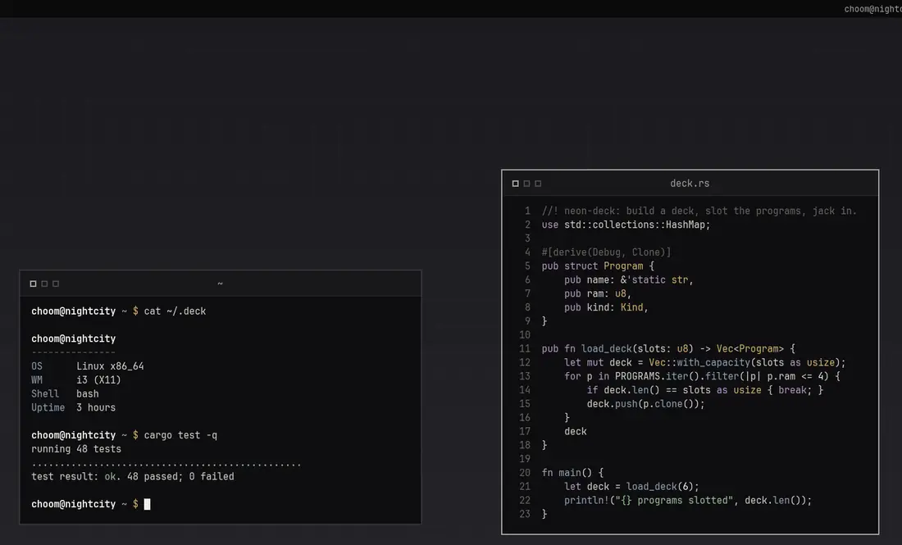
  <br>
  <sub>Drops in on a bolt. Sits down. Tells you when your agent needs you.</sub>
</p>

**Capri** lives on your desktop. She sits on your windows, wanders off when she's bored, naps when
you're away and comes to find you when she wants attention.

She also talks. Tap a key and type, or say "Hey Capri": she answers, does things on your machine, and
comes over when she needs you. Her brain is the real thing, an agent session on
[Synaps](https://github.com/HaseebKhalid1507/SynapsCLI), the runtime she's built on. The installer
brings it along.

She's a click-through overlay written in Rust and drawn with GPUI, on X11 and Hyprland (Windows is on
its way). Your windows stay yours. She just sits on them.

<p align="center">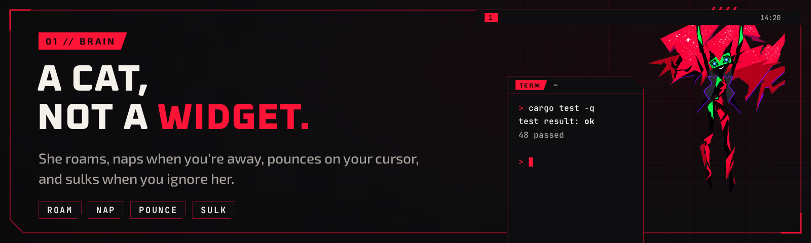</p>

## She lives here

Nobody scripts her day. Two drives run in the background, one for wandering and one for attention,
and she acts when one of them wins.

<table>
  <tr>
    <td width="50%" align="center">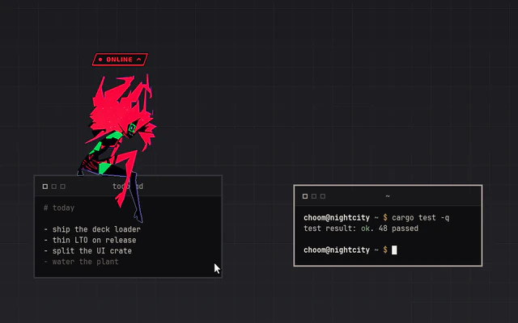<br><b>Window tops</b><br><sub>Her favourite seat. Close it and she glitches to the next one.</sub></td>
    <td width="50%" align="center">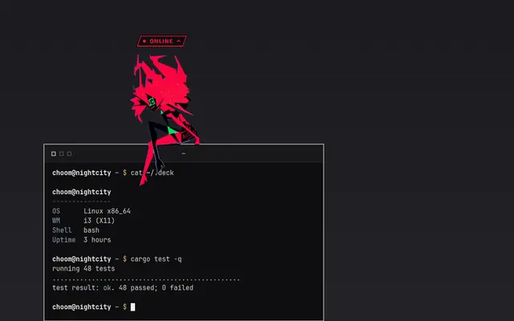<br><b>Perch</b><br><sub>Rides your windows. Lies down when it's quiet.</sub></td>
  </tr>
  <tr>
    <td width="50%" align="center">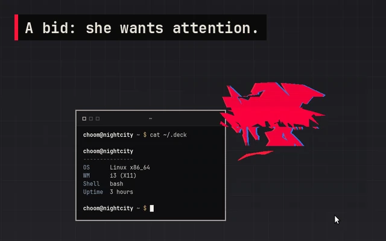<br><b>Attention bids</b><br><sub>Wants attention. Will hang off your bar for it.</sub></td>
    <td width="50%" align="center">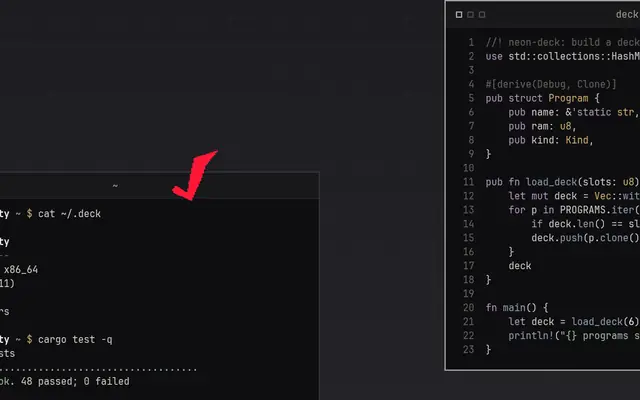<br><b>Summon</b><br><sub>Your agent needs a yes? She comes to you.</sub></td>
  </tr>
</table>

<p align="center">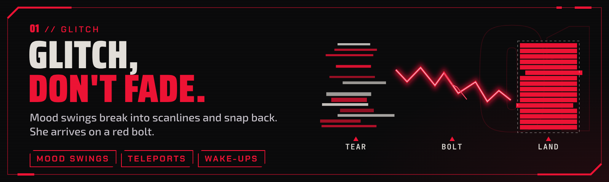</p>

## She has a day

<table>
  <tr>
    <td width="50%" align="center">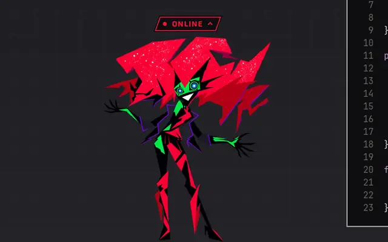<br><b>Naps</b><br><sub>Lock the screen, she sleeps. Come back, she says hi.</sub></td>
    <td width="50%" align="center">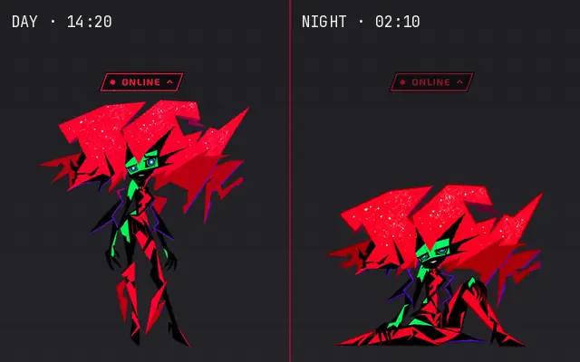<br><b>Day and night</b><br><sub>Bright by day. Low-key after dark.</sub></td>
  </tr>
  <tr>
    <td width="50%" align="center">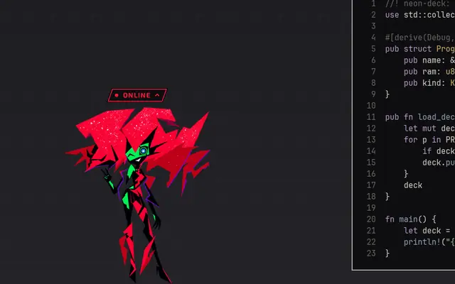<br><b>Cursor games</b><br><sub>Wiggle the pointer near her. She will pounce.</sub></td>
    <td width="50%" align="center">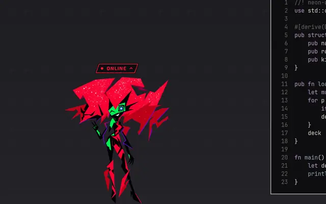<br><b>Sulks</b><br><sub>Ignore her and she sulks. A headpat fixes it.</sub></td>
  </tr>
</table>

- **She stays up while you work.** She naps 10 minutes after your last input (5 at night), and at once
  when the screen locks or the machine sleeps. Back after an unlock or a while away, she greets you,
  a few times a day at most. Up from a long nap, she stretches.
- **She keeps her own hours.** By day she's lively: hands on hips, a shrug, a hop. Late at night her
  energy runs low, she sits on the floor more, breathes slower, and now and then dozes off even
  while you're there. News from her session wakes her.
- **She plays.** Rest the pointer beside her and she leans in, curious. Wiggle it and she points at
  it. Stop dead after a wiggle and she pounces, landing beside it, never on it.
- **She spaces things out.** Her small actions come in shuffled rounds with gaps that depend on her
  energy, so she doesn't tick like a metronome.

## Hands on

<table>
  <tr>
    <td width="50%" align="center">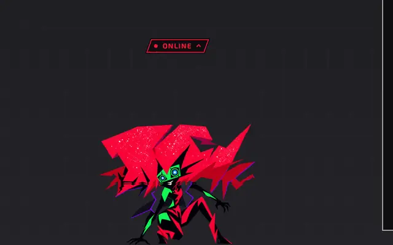<br><b>Headpats</b><br><sub>Headpats are supported. Hearts are not optional.</sub></td>
    <td width="50%" align="center">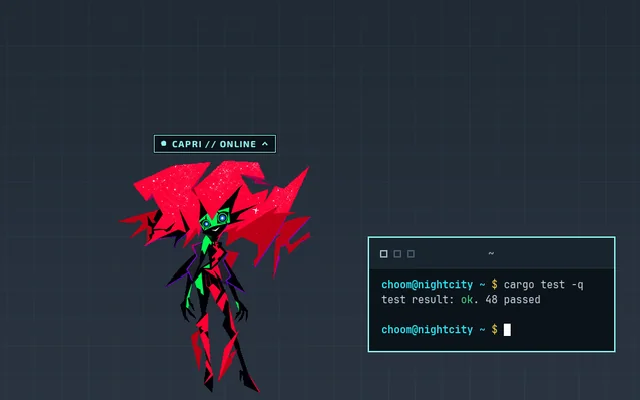<br><b>Ragdoll</b><br><sub>Grab her, shake her, fling her. She lands it.</sub></td>
  </tr>
  <tr>
    <td width="50%" align="center">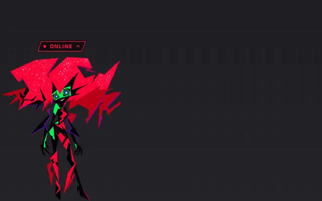<br><b>Walks</b><br><sub>Sometimes she just walks over.</sub></td>
    <td width="50%" align="center">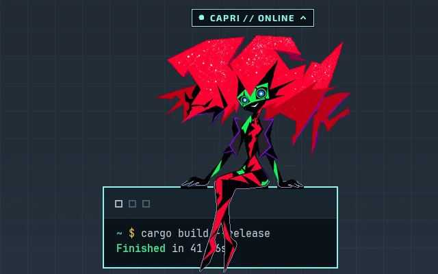<br><b>Music</b><br><sub>Something's playing? Headphones on. Sometimes she dances.</sub></td>
  </tr>
</table>

<p align="center"></p>

## She's your line in

Capri has her own Synaps session, named `capri`. The Line is how you reach it without leaving what
you're doing. It opens right beside her, wherever she is.

It's an ordinary session, so a terminal can join it too: `synaps --attach capri` opens the same thread
in the Synaps TUI. Type in either one.

<p align="center">
  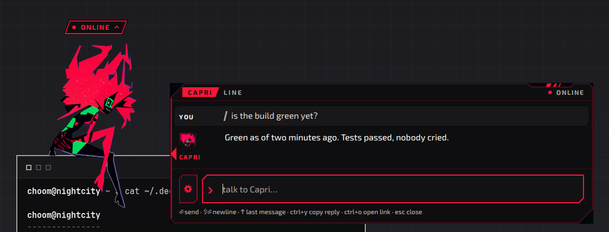
  <br><b>The Line</b><br>
  <sub>Tap $mod+c. Type. She relays it to her session.</sub>
</p>

<p align="center">
  
  <br><b>Hold to allow</b><br>
  <sub>Risky tool call? Hold A. A tap does nothing.</sub>
</p>

<p align="center">
  
  <br><b>Reader</b><br>
  <sub>Long reply? It opens in a reader, not a bubble.</sub>
</p>

<table>
  <tr>
    <td width="50%" align="center">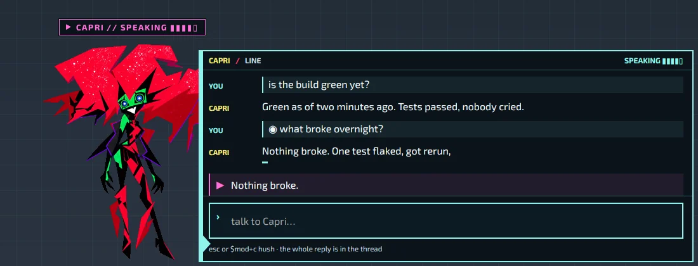<br><b>Hey Capri</b><br><sub>Say her name. Talk. She answers aloud.</sub></td>
    <td width="50%" align="center"><br><b>Moods</b><br><sub>Her mood is your session's: thinking, working, done.</sub></td>
  </tr>
</table>

- **The thread stays open.** Enter sends, or steers a turn that's already running. Esc closes and keeps
  your draft. Esc Esc aborts the turn.
- **A reply you missed waits for you.** It leaves a one-line strip on her tag until you look.
- **Prompts are answered from the keyboard.** <kbd>A</kbd> allows, <kbd>D</kbd> denies, <kbd>Tab</kbd>
  lets you say something instead, <kbd>Esc</kbd> puts it off. Anything that runs, writes or deletes needs
  <kbd>A</kbd> held for about half a second, so a stray keypress can't approve it.
- **She's a real agent. Treat her like one.** Her session has Synaps's tools, so it can run commands and
  edit files as you. A prompt appears only when something asks for one, such as an extension that guards
  tool calls; whether anything asks before a command depends on what your Synaps has installed. It isn't
  a sandbox. [What she can touch](docs/UNDER-THE-HOOD.md#what-she-can-touch).
- **Voice is opt-in and local.** Hold the key to talk, or tap the toggle chord and pause when you're done.
  Say **"Hey Capri"** and it turns into a hands-free conversation: each pause sends, she answers aloud,
  and after a minute of quiet she goes back to waiting for her name. Speech-to-text is whisper.cpp and
  her voice is Kokoro, both on the CPU. Audio stays in memory; nothing is written to disk. The open mic
  always shows on her tag.
- **She minds the room.** Other audio is turned down while she listens or speaks, not paused, and comes
  back after. She speaks her replies to things that arrive on their own, never over music. Noise that
  speech-to-text turns into junk is dropped instead of sent.

## How it works

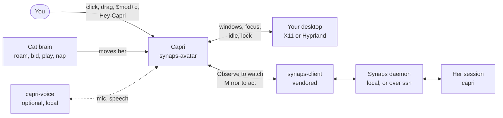

She is one process: a transparent GPUI window plus a client of the Synaps daemon. The daemon can be on
this machine or on another one behind an ssh tunnel. The client is vendored, so the repository builds
on its own, with no private dependencies.

**She watches, and only steps in to act.** Capri attaches to her session in `Observe`. A `Mirror` attach
would keep the session from parking and cost tokens in keep-warm pings, so she takes one only to send,
answer a prompt or abort, and drops back to `Observe` three seconds after the turn ends.

**Her own session.** With no `--session` flag she uses a session named after the pack's character
(`capri`): attaches if it's live, resumes it if she remembers it, creates it otherwise. She rides another
session only when you pass `--session`, and she refuses the one named `subconscious`.

**Her mood is the session's.** Thinking, working (with the tool's name), talking, done, annoyed after an
abort or an error, needs-you while a prompt is pending, away when the daemon is gone. Away fixes itself
when the daemon comes back. Sleep is yours, not the session's: she naps when you're away.

### The cat brain

- **Roam.** Every 45 seconds to 3 minutes she picks a new spot, most often the top edge of a window (her
  favourite), else the floor or a corner. Four times in five it's on the monitor your pointer is on. In
  between she does small hops: along the edge she sits on, to the next window over, down and back up.
- **React.** Switch windows and about one time in three she hops to the new one's edge. Drag her window
  fast and she hops off, startled. Bring the pointer close and she looks at it; rest it beside her and
  she leans in; rest it on her and she dodges or leans in for a headpat. Switch workspace and she
  follows you within a couple of seconds. Close the window she's sitting on and, a bit over half the
  time, she glitches over to the top of another one; otherwise she falls. While you type fast she only
  does the small hops, away from your window.
- **Bid.** Leave her alone long enough (8 to 15 minutes) and she comes over: hanging from the bar above
  your window, clinging to its side, sitting on its edge, peeking round a corner. She avoids her last
  two entrances. Ignore the bid and she insists, then sulks with her back to you. A headpat makes up.
- **Summon.** When her session needs you (a prompt, a finished turn, an error) she comes straight to the
  window you're in, unless she's already beside you. This is the one move that isn't her idea.
- **Manners.** She doesn't wander off mid-conversation: an open bubble, the Line or her menu keeps her
  where she is. She hides when a window goes fullscreen on her monitor, makes at most 45 moves an hour
  on her own (a small hop counts a quarter), stays off the window you're working in unless she's come
  over for you, and takes `DND 1 HOUR` from the right-click menu.

## What's running her

[Synaps](https://github.com/HaseebKhalid1507/SynapsCLI). An open-source agent runtime in Rust: one
background daemon that owns every session, hers included. She's a client of it, the same as a terminal
would be. So:

- `synaps --attach capri` opens her thread in a terminal.
- `synaps send --session capri "tea's ready"` and she comes over to tell you. Any script can do that.
- `[session] model` in her settings picks her brain: any model Synaps can reach.
- `synaps` on its own starts a session that's yours, not hers. One agent, or a crew.

The longer tour, and what she can and can't touch: [docs/UNDER-THE-HOOD.md](docs/UNDER-THE-HOOD.md).

## Install

```sh
curl -fsSL https://raw.githubusercontent.com/HaseebKhalid1507/capri-syn/main/install.sh | bash
```

One line. It installs [Synaps](https://github.com/HaseebKhalid1507/SynapsCLI) first if you don't have
it, then her, her art pack, the summon key and autostart, and starts her. It asks before anything
needs sudo, and `--dry-run` prints every step without doing one.

She needs a brain to answer: until Synaps has a model her tag reads NO BRAIN YET. Say hi and she
tells you the one command (a Claude subscription: `synaps login --provider claude`, which opens your
browser). Without one she still perches, naps and plays. No account? A local model works through
Ollama: [the steps](docs/UNDER-THE-HOOD.md#her-brain).

`--uninstall` removes what it added and tells you where Synaps is. Every step, every flag and the manual
route: [docs/INSTALL.md](docs/INSTALL.md).

On Windows (in progress): `irm https://raw.githubusercontent.com/HaseebKhalid1507/capri-syn/main/install.ps1 | iex`,
or her installer, `capri-syn-setup-x86_64.exe`: it installs Synaps if you don't have it, downloads
her art, starts her brain's daemon and offers the Claude sign-in at the end.

Her art isn't in this repository: it's assembled on your machine from
[CapriCore](https://github.com/CapriChooms/CapriCore) and
[lachydotmcg/capri-desktop](https://github.com/lachydotmcg/capri-desktop) (see [Credits](#credits--legal)).

## Configure

Settings live in `~/.config/synaps-avatar/settings.toml`. Every key is optional. This file shows the
defaults.

```toml
[brain]
enabled = true
attention = "mix"            # "mix" | "hang_only" | "off"  (also in the right-click menu)
fullscreen = "hide"          # "hide" | "stay"
monitor = "follow"           # "follow" the monitor you work on | "any"
passive_every_min = [0.75, 3] # minutes between her own roams (small hops in between)
bid_every_min = [8, 15]      # minutes between attention bids
max_moves_per_hour = 45      # a small hop counts a quarter
no_repeat = 2                # avoid her last N entrances

[brain.approaches]           # how she shows up for a bid; weights, 0 turns one off
hang = 2
hang_upside_down = 1
cling = 3
sit_edge = 3
peek = 1
beside = 1

[brain.arrivals]             # how she gets there (hop = 0: no hops at all)
hop = 4
teleport = 2
drop_in = 2
glitch = 1

[ragdoll]
strength = 0.5               # 0 = rigid, 1 = full floppy

[mirror]
drag_facing = "back"         # dragged, she looks "back" where she came from, or "forward"

[display]
composited = "auto"          # "auto" | "on" (alpha) | "off" (X shape, no compositor needed)

[music]
detect = true                # headphones on (now and then a dance) while an MPRIS player plays
ignore = ["discord", "vesktop"]

[voice]
enabled = false              # talk to her and hear her answer, through capri-voice
wake_word = true             # "Hey Capri" (with voice on): one mic stream, always shown on her tag
duck = "duck"                # other audio while she listens or speaks: "duck" | "pause" | "off"
```

An unknown key makes her reject the whole file and keep the previous values, so check spelling.
`avatarctl settings reload` applies changes without a restart.

Every setting and flag, the session rules, the pack format and the dev control:
[docs/REFERENCE.md](docs/REFERENCE.md). Voice in depth: [docs/VOICE.md](docs/VOICE.md). Optional event
hooks (`tools/capri-watch`, one short line into her session when something on your machine needs a
look): [docs/WATCH.md](docs/WATCH.md).

## Controls

| You | She |
|---|---|
| Click her body | Reacts, and opens a quick text field |
| Click her head | Headpat |
| Keep poking her | Gets annoyed |
| Drag her | Goes limp and swings; drop her on a window edge to perch her there |
| Fling her | Flies, lands, and may take it personally |
| Right-click | Menu: reset position, DND 1 hour, attention mix / hang only / off, hands-free talk, copy last reply, hide, quit (asks twice) |
| <kbd>$mod</kbd>+<kbd>c</kbd>, tap | Opens the Line beside her (she stays put). Tap again to close |
| <kbd>$mod</kbd>+<kbd>c</kbd>, hold | Push-to-talk. Release sends (voice on) |
| <kbd>$mod</kbd>+<kbd>Ctrl</kbd>+<kbd>c</kbd> | Toggle talk: your pause sends. Double-tap for hands-free |
| "Hey Capri" | Hands-free conversation (voice on) |
| <kbd>Enter</kbd> | Send, or steer a running turn |
| <kbd>Shift</kbd>+<kbd>Enter</kbd> | New line |
| <kbd>↑</kbd> <kbd>↓</kbd> | Recall what you sent |
| <kbd>PgUp</kbd> <kbd>PgDn</kbd> | Scroll the thread |
| <kbd>Ctrl</kbd>+<kbd>Y</kbd> | Copy her last reply |
| <kbd>Ctrl</kbd>+<kbd>O</kbd> | Open the last link in it |
| <kbd>Esc</kbd> | Close the Line (draft kept). While she's speaking: hush. While listening: cancel |
| <kbd>Esc</kbd> <kbd>Esc</kbd> | Abort the running turn |
| <kbd>A</kbd> / hold <kbd>A</kbd> | Allow a prompt / allow a risky one (about half a second) |
| <kbd>D</kbd> | Deny |
| <kbd>Tab</kbd> | Answer in words instead |

The app doesn't grab global keys on Linux: bind them in your window manager. In i3:

```
bindsym $mod+c             exec --no-startup-id avatarctl talk press
bindsym --release $mod+c   exec --no-startup-id avatarctl talk release
bindsym $mod+Ctrl+c        exec --no-startup-id avatarctl talk toggle
```

On Windows she registers <kbd>Win</kbd>+<kbd>Alt</kbd>+<kbd>C</kbd> (the Line) and
<kbd>Win</kbd>+<kbd>Alt</kbd>+<kbd>Ctrl</kbd>+<kbd>C</kbd> (toggle talk) herself.

## Platforms

| | status |
|---|---|
| **Linux, X11** | Her home. Built and used daily on i3, with or without a compositor. Every clip on this page is X11. |
| **Linux, Hyprland** | Works: perching, drag and fling, effects, several monitors. Tested in a nested Hyprland rig, not yet daily-driven. No idle time there yet, so typing alone for 5 minutes reads as away. |
| **Other Wayland desktops** | Not supported. `SA_BACKEND=x11` runs her through XWayland. |
| **Windows 11** | In progress. CI builds, tests and lints it and builds an installer on every push, but it hasn't been run on real hardware or in the VM yet: [14 checks are open](docs/WINDOWS.md#vm-pending-one-vm-day). |
| **macOS** | Not planned. |

- **Names.** The repository is `capri-syn`. The crate, the binary and the config and state paths are
  still `synaps-avatar`; a rename comes later.
- **One character.** The code ships no character ids. Everything Capri-specific is in her pack's
  `moods.json`, so another pack is possible. Capri is the only one that exists.

## Credits & legal

- **The art.** Capri's sprite art is by CapriChooms
  ([CapriCore](https://github.com/CapriChooms/CapriCore)). It is not included in this repository:
  `tools/make-pack` assembles the pack on your machine from your own CapriCore checkout.
- **Desktop art.** Her perch, sleep, walk, dance, dangle and transition animations come from Capri,
  [lachydotmcg/capri-desktop](https://github.com/lachydotmcg/capri-desktop), under the
  [PolyForm Noncommercial License 1.0.0](https://polyformproject.org/licenses/noncommercial/1.0.0).
  They are not included in this repository either: `tools/make-pack --lachy` adds them to your local pack.
  Window perch and music perch animations: her artist, who prefers to stay private. Click effect: mixmix312352.
  Transformation animation and emotes: Qewiw (mix_qewiw1412_86144).

  > Required Notice: Copyright 2026 Lachy (https://github.com/lachydotmcg)
  >
  > Required Notice: Anyone who uses Capri's code, art, animations or any of its other assets must credit the Capri project (https://github.com/lachydotmcg/capri-desktop). Capri's art and animations are by her artist, who prefers to stay private. Parts made by others keep their own licences, listed in its README.
- **The media on this page.** The clips show the app running with a pack assembled from those two
  sources, on a staged desktop. The banner uses lachy's perch drawing; the cards are composed from the
  same captures and one frame of lachy's teleport animation. The artwork in all of them remains its
  artists'.
- **Unofficial.** This is a fan project. It is not affiliated with or endorsed by CD PROJEKT RED,
  R. Talsorian Games, Studio Trigger or Netflix. All trademarks belong to their owners.
- **Her voice.** Speech uses stock Kokoro voices, blended, with light DSP. Nothing is cloned and nobody's voice
  is imitated.
- **Built on** [Synaps](https://github.com/HaseebKhalid1507/SynapsCLI) and
  [GPUI](https://www.gpui.rs/).

<p align="center">
  <sub>Capri runs on <a href="https://github.com/HaseebKhalid1507/SynapsCLI">Synaps</a>. Synaps is built with Synaps.</sub>
</p>
